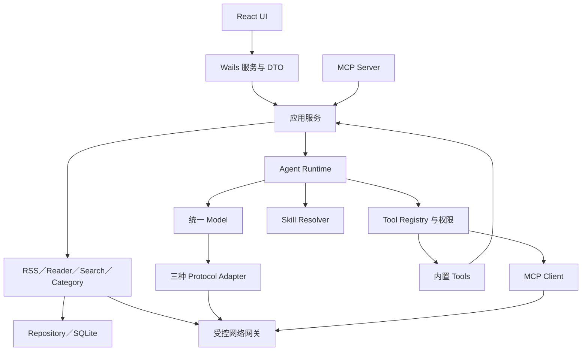

# 总体架构

状态：整体架构为已评审基线；Phase 0 已实现 main／internal/app 与前端绑定，其他领域仍为拟定契约。依据 [范围](../00-product/scope.md)与 ADR-0001 至 0012。

图中的内置 Tool 回调应用服务通过明确小接口调用，不能递归进入同一个 Agent Run。数据库与网络只能由 Go 持有；运行时不直接写 SQL，厂商数据类型不得跨 Adapter 边界。

## 生命周期

启动：定位平台数据目录 → 获取单实例数据锁 → 备份并迁移 → 建立仓储与凭据服务 → 注册服务与工具 → 创建窗口 → 启动到期调度器。迁移失败进入诊断界面，禁止继续写库。停止：禁止新任务 → 取消可取消操作 → 等待有界收尾 → 保存设置 → 关闭连接。没有模型配置也正常启动。

## 数据所有权

SQLite 是事实源，Query 是前端缓存，Zustand 是界面状态。调度、UI、Agent、MCP 都通过同一应用服务修改领域数据；提交后发失效事件。日志、执行审计与文章内容分开；模型上下文不自动包含全库。

## 技术边界

原生 GUI 构建依赖平台 SDK；纯 Go SQLite 不消除 Wails 原生依赖。各阶段先完成纵向用户路径，再增加模块，不预置微服务、消息中间件或万能 Manager。详细契约见 [Wails API](../05-api/wails-bindings.md)、[数据库](database.md)、[安全](security.md)。

验收 ARCH-01：UI／Agent／MCP 经同一应用服务，业务不依赖厂商类型，零 AI 启动和读库路径独立；依赖边界与数据所有权检查通过。
